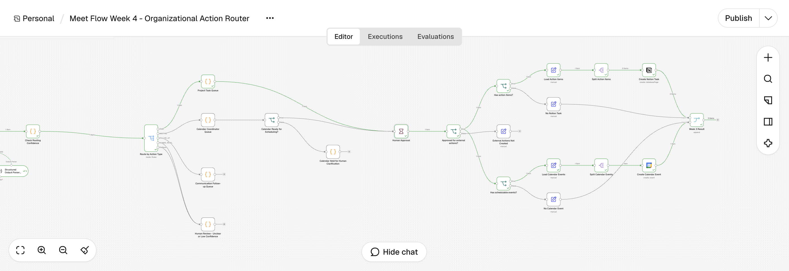
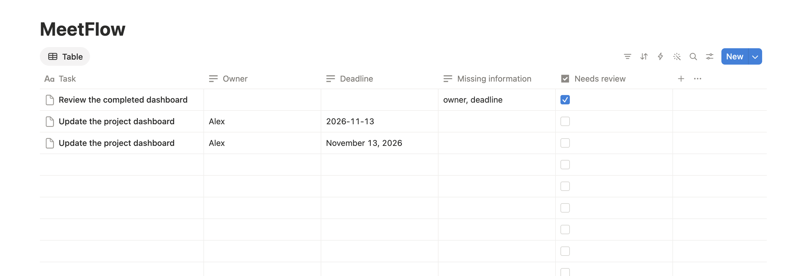
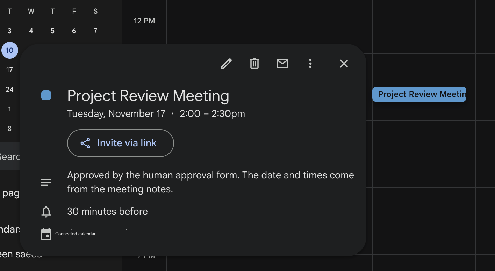
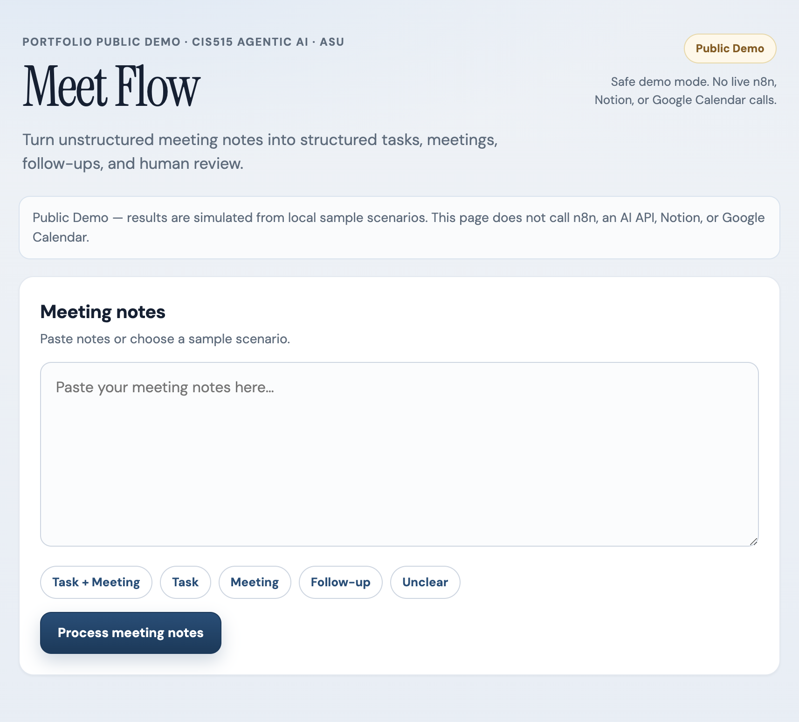
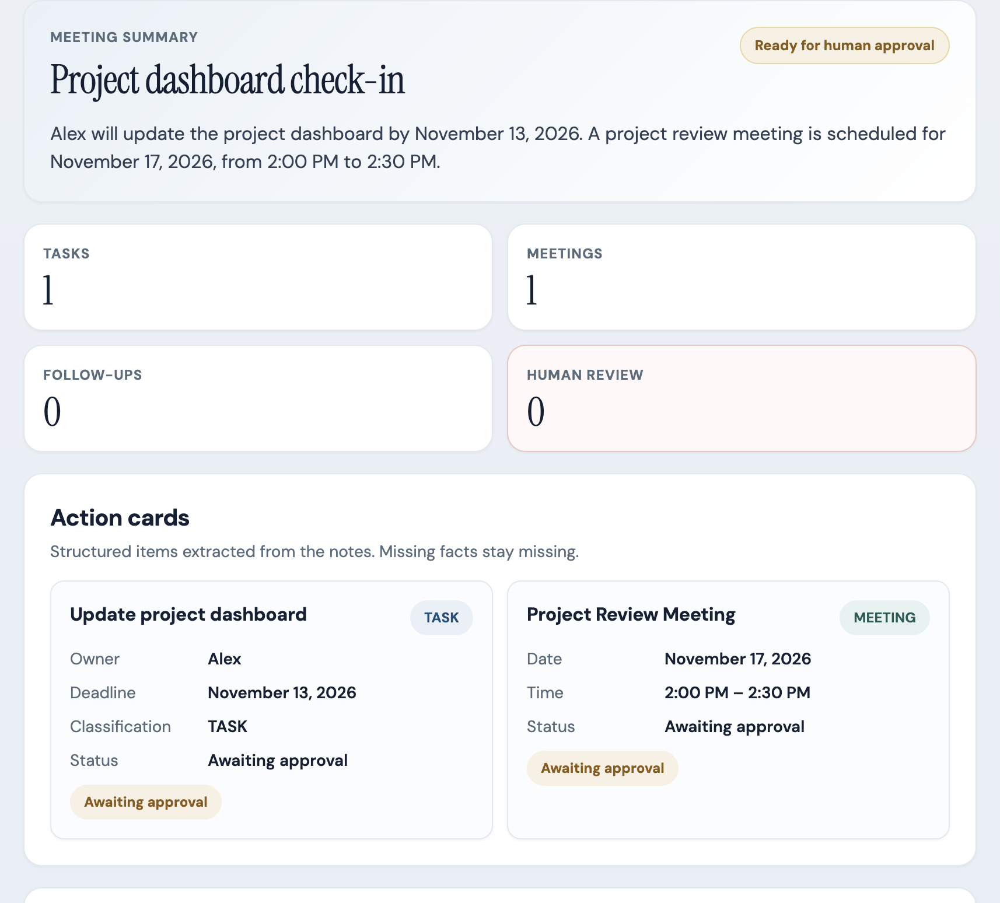
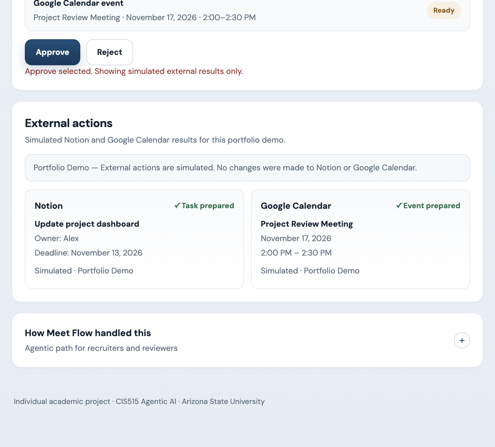
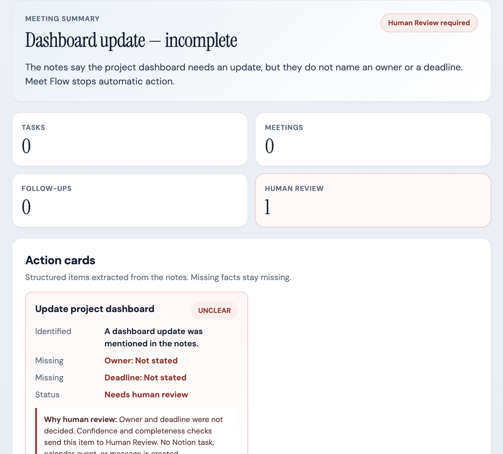

# Meet Flow — Agentic AI Meeting Assistant

Meet Flow turns unstructured meeting notes into structured tasks, meetings, follow-ups, and items that need human review. It classifies each action, routes it to the right organizational owner, and only calls external tools after validation and human approval.

This repository presents the final Meet Flow system from my individual academic project in **CIS 515 — AI and Data Analytics Strategy** at **Arizona State University**.

---

## Problem

Meeting notes are often messy. Action items, owners, deadlines, and meeting times are mixed into informal text. Without structure and controls, automation can invent missing details, assign work to the wrong person, or create tasks and calendar events before anyone has reviewed them.

## Solution

Meet Flow is an n8n agentic workflow that:

1. Drafts and reviews a meeting summary against the original notes  
2. Extracts tasks and calendar events without filling in missing facts  
3. Classifies each item as **Task**, **Meeting**, **Follow-up**, or **Unclear**  
4. Routes it to the appropriate owner  
5. Stops unclear or low-confidence cases at **Human Review**  
6. Requires **Human Approval** before Notion or Google Calendar runs  

---

## How it works

```text
Meeting notes
    → AI draft + review (one revision if needed)
    → Structure tasks and events (no invented facts)
    → Classify and score confidence
    → Route by action type
         TASK / MEETING / FOLLOW_UP / UNCLEAR
    → Human Review when needed
    → Human Approval
    → Notion and/or Google Calendar (only when facts are complete)
```

After **Approve**, the workflow checks tools independently:

- Action items present → create Notion task(s)  
- Schedulable event present → create Google Calendar event  
- Both can run in the **same** execution  

---

## Architecture



*Final Meet Flow execution: after human approval, the workflow created a Notion task and a Google Calendar event in one run.*

| Category | Owner | What happens |
| --- | --- | --- |
| TASK | Project / Task Owner | Notion after Approve, when a complete task was extracted |
| MEETING | Calendar / Meeting Coordinator | Google Calendar after Approve, when date and times are complete |
| FOLLOW_UP | Communication / Follow-up Owner | Queued for a person; no email is sent |
| UNCLEAR | Human Reviewer | Stop; no external action |

More detail: [docs/architecture.md](docs/architecture.md)

---

## Agentic AI design

Meet Flow separates **thinking**, **checking**, and **doing**:

- **Draft agent** — writes the first meeting summary  
- **Reviewer** — judges the draft against the notes (`PASS` or `REVISE`); one revision cycle  
- **Classifier** — recommends category, owner, confidence, and a short reason  
- **Code validation** — keeps only facts stated in the notes; accepts calendar slots only as `YYYY-MM-DD` and 24-hour `HH:MM`  
- **Tools** — Notion and Google Calendar run only after human approval and only for validated outputs  

The model organizes and recommends. It does not replace the decision to publish a task or put a meeting on the calendar.

---

## Human-in-the-loop

Two different human controls:

| Control | Purpose |
| --- | --- |
| **Human Review** | Handles unclear or low-confidence items, or notes that still require confirmation. No Notion task, calendar event, or message is created from this stop. |
| **Human Approval** | Form choice: **Approve** or **Do not create**. Approve may reach Notion and/or Google Calendar. Do not create stops both. |

---

## Guardrails

- Do not invent owners, deadlines, dates, or times  
- Confidence below **0.75** → Human Review  
- Confirmation language (for example, “confirm with Alex first”) → Human Review  
- Incomplete meeting details → held for clarification; no guessed calendar slot  
- Follow-ups stay with a person; the workflow does not send email  
- Notion and Calendar sit behind approval and their own completeness checks  

---

## Tools and technologies

- **n8n** — agentic workflow orchestration  
- **OpenAI-compatible LLM** (`gpt-4o-mini` via course gateway) — draft, review, classify  
- **JavaScript Code nodes** — task/event structuring and routing guardrails  
- **Notion** — task creation  
- **Google Calendar** — meeting creation  
- **HTML / CSS / JavaScript** — Public demo dashboard (local samples today; ready for an n8n processor URL)  

Credentials are **not** stored in this repository. Import the workflow into n8n and connect your own Notion, Google Calendar, and model credentials.

---

## Successful test (task + calendar)

**Input (combined note):** Alex will update the project dashboard by November 13, 2026, and a project review is scheduled for November 17, 2026, 2:00–2:30 PM.

**Approval:** Approve  

**Result:** In the same execution, Meet Flow created:

1. A **Notion** task for the dashboard update (owner Alex, deadline November 13, 2026)  
2. A **Google Calendar** event titled Project Review Meeting (November 17, 2:00–2:30 PM), with a description noting approval and that date/time came from the notes  



*Notion output from the final test.*



*Google Calendar output from the final test (account name redacted for privacy).*

An earlier unclear note with no owner or deadline stopped at Human Review with no external action. The follow-up route exists in the workflow; it is not claimed as a separately completed execution in this portfolio.

---

## Key features

- AI processing of unstructured meeting notes  
- Classification into Task, Meeting, Follow-up, or Unclear  
- Organizational routing to role-based owners  
- Human Review for unclear or uncertain information  
- Human Approval before external actions  
- Notion integration for tasks  
- Google Calendar integration for meetings  
- Combined Notion + Calendar creation from one approved run  
- Public demo UI with processing stages, action cards, Human Approval simulation, and simulated tool results  

---

## Public demo dashboard

The `dashboard/` folder is a portfolio UI for **Meet Flow — Agentic AI Meeting Assistant**. It currently uses local sample scenarios (`config.js` → `MODE: "local"`). The same result UI is ready to switch to a live n8n processor URL later without a redesign.

```bash
cd dashboard
python3 -m http.server 8765
```

Open `http://127.0.0.1:8765`. Optional: `?demo=both`, `task`, `meeting`, `follow`, or `unclear`.



*Public demo home — paste notes or choose a sample scenario.*



*Results focus — Meeting Processed header, summary, stats, and action cards.*



*After Approve — simulated Notion and Google Calendar outputs.*



*Unclear notes — missing owner/deadline stay “Not stated” and stop for Human Review.*

See [docs/public-demo.md](docs/public-demo.md) for the safety model and live-processor switch.

---

## Repository layout

```text
workflow/     Final n8n workflow + JavaScript helpers
dashboard/    PUBLIC_DEMO UI (simulated results only)
screenshots/  n8n evidence + public demo UI captures
docs/         Architecture, course evolution, public demo notes
```

Course week folders from CIS 515 are kept on my local machine for academic history and are **not** included in this public repository.

---

## Setup (n8n)

1. Import `workflow/Meet_Flow_Week4_FINAL_SIMPLE_V2.json` into n8n  
2. Select model credentials on each OpenAI Chat Model node  
3. Connect Notion (database properties: Task/Title, Owner, Deadline, Missing information, Needs review, Week 2 route)  
4. Connect Google Calendar  
5. Set workflow timezone as needed for your calendar tests  

Helper logic used in the design lives under `workflow/src/`.

---

## What I learned

- Tool-using agents need validation before side effects  
- Classification and ownership are separate from “can we call a tool?”  
- Human Review and Human Approval solve different problems  
- Confidence thresholds and confirmation language are practical guardrails  
- One meeting can contain more than one kind of work; tools should gate independently after approval  

---

## Academic context

Individual project for **CIS 515 — AI and Data Analytics Strategy**, Arizona State University. Design evolved from a basic meeting-notes assistant to a tool-using workflow with human approval, then to an organizational action router. See [docs/course-evolution.md](docs/course-evolution.md).
